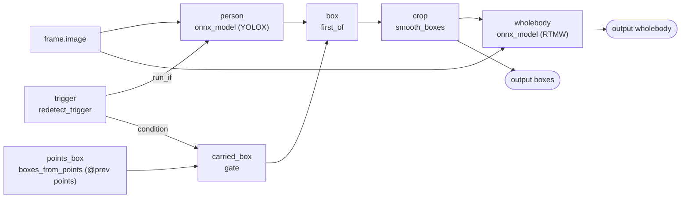

import { AiGeneratedBanner } from '@freemocap/skellydocs';

<AiGeneratedBanner />

# Pipeline Overview

A pipeline is one YAML file. It connects models and glue steps into a graph. A run takes the file
and the frames of one or more cameras. It gives the outputs of each camera.

The pipeline file does not define how a model processes an image. The sidecar of the model gives
the preprocessing, the inference and the postprocessing. See [Detectors](../core-concepts/detectors).

## The parts of a pipeline file

| Key | Required | What it holds |
|---|---|---|
| `schema_version` | yes | The pipeline spec version, in quotes. Until 2.0.0 is released, the only valid value is `"2.0.0"`. |
| `pipeline_id` | yes | The id of the pipeline. The file name is `<pipeline_id>.pipeline.yaml`. |
| `source` | yes | `{name, version}`: who made the file, and the version of the file. |
| `description` | no | Text for people. |
| `nodes` | yes | The nodes of the graph, in any order. |
| `outputs` | yes | The delivered outputs: one or more of the keys `wholebody`, `holistic` and `boxes`. |
| `instrumentation` | no | The timing spans and the taps. |

The key of a pipeline is `<pipeline_id>@<source.name>`, for example
`yolox-rtmw-wholebody@skellytracker`. A load can pin a version with `==<version>`.

This is the built-in file `mediapipe-holistic-tasks.pipeline.yaml`:

```yaml
schema_version: "2.0.0"
pipeline_id: mediapipe-holistic-tasks
source: {name: skellytracker, version: "2.0.0"}
description: |-
  MediaPipe Holistic, one Tasks landmarker on the full frame.

  Built-in pipeline of v2.0.0. It shows one mediapipe_tasks node: the MediaPipe Holistic landmarker
  on the full frame. Holistic is single person, so max_instances is 1. The points have the groups
  body, right_hand, left_hand and face, in this order. The output is geometry 3d with depth_unit
  pixel: z is the MediaPipe depth, scaled by the image width.
nodes:
  - id: holistic
    type: mediapipe_tasks
    inputs: {image: frame.image}
    params: {variant: holistic}
outputs:
  holistic: holistic.keypoints
```

## Nodes and ports

Each node has an `id`, a `type`, `inputs` and `params`. A port is a named input or output of a
node. An input refers to an output port as `<node>.<port>`, for example `person.boxes`.

- `frame.image` is the camera frame of the call. It is the only image of the graph.
- The suffix `@prev` gives the value of the port on the previous frame of the same camera. The
  value is empty on the first frame.
- The port types are `image`, `boxes`, `keypoints` and `flag`.
- A node that gets an empty required input does not run. Its outputs are then empty.

The node types are a closed set. A pipeline file runs no user code.

| Kind | Node types |
|---|---|
| Inference nodes | `onnx_model`, `mediapipe_tasks` |
| Glue nodes | `boxes_from_points`, `hold_boxes`, `gate`, `first_of`, `assign_keypoints`, `merge`, `flag_when`, `smooth_keypoints`, `smooth_boxes`, `redetect_trigger` |

An `onnx_model` node refers to its model by `key` and `sidecar_sha256`. A built-in file must give
the `sidecar_sha256` of each `onnx_model` node.

To list each node type with its ports and params, run:

```sh
uv run skellytracker nodes
```

## The built-in pipeline `yolox-rtmw-wholebody`



The person detector runs on the first frame, then each 150 frames, and on the frame after a lost
person. On each other frame, the box comes from the points of the previous frame. A One Euro filter
smooths the box on each frame. RTMW finds 133 whole-body points in the box.

## Load and check a pipeline

```python
from skellytracker.core.pipelines import check_pipeline, list_pipelines, load_pipeline

for entry in list_pipelines():
    print(entry.key, entry.version, entry.available, entry.needs_execution_provider)

config = load_pipeline("yolox-rtmw-wholebody@skellytracker")
check = check_pipeline(config)
print([node.id for node in config.nodes])
print(list(check.output_schema))           # ['wholebody', 'boxes']
print([warning.code for warning in check.warnings])
```

- `load_pipeline` takes a key, the path of a YAML or JSON file, or a mapping.
- An unknown key at any level of the config is an error. `load_pipeline` raises `ValueError` with the
  rule ID.
- An absent ONNX file or an absent extra is not a load error. `check_pipeline` gives the warning
  `missing_dependency`, and a start fails.
- The CLI command `uv run skellytracker validate <file or key>` runs the same load checks.

## Where the catalog finds pipeline files

The catalog reads each `*.pipeline.yaml` file in two folders:

- the package folder `skellytracker/core/model_zoo/pipelines/`;
- `<user root>/pipelines/`. The user root is the argument `user_root`, else the environment
  variable `SKELLYTRACKER_USER_ROOT`, else the folder `models` in the user data folder of skellytracker.

The source name `skellytracker` is reserved for the package folder. When the catalog has two
versions of one key, the newest `source.version` wins.

## See also

- [Running Modes](../core-concepts/running-modes): start a run and give it frames.
- [Outputs and Keypoints](../core-concepts/outputs-and-keypoints): read the result.
- [Extending skellytracker](../guides/extending-skellytracker): write your own pipeline file.
- The [pipeline spec](https://github.com/freemocap/skellytracker/blob/development/specs/pipeline/README.md).
