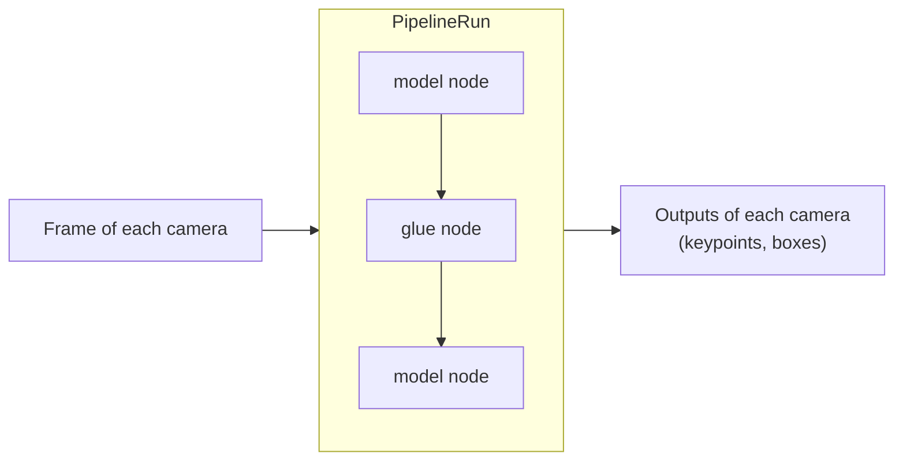

import { AiGeneratedBanner } from '@freemocap/skellydocs';

<AiGeneratedBanner />

:::warning AI GENERATED DOCS
An AI agent wrote these pages from the code of the 2.0.0 work. A person did not review them yet.
skellytracker 2.0.0 is work in progress. The API can change before the release.
:::

# skellytracker

**skellytracker** is the tracking backend for [FreeMoCap](https://freemocap.org).
It finds the keypoints of a person in camera frames.
It runs on images, video files and live cameras.

## How it works

You run a **pipeline**. A pipeline is one YAML file that connects models and glue steps into a graph.
A run takes the frames of one or more cameras. It gives the outputs of each camera.

The package has three entry points:

| Entry point | Use it to |
|---|---|
| `skellytracker.core.pipelines` | Load a pipeline and run it on frames |
| `skellytracker.core.detectors` | List the detectors and make one detector, for example a charuco board detector |
| `skellytracker.core.eps` | Find, install and select the execution provider (EP) that runs the ONNX models |

`skellytracker.certify()` tests the EPs on your system.

## Built-in pipelines

| Key | What it does |
|---|---|
| `mediapipe-holistic-tasks@skellytracker` | MediaPipe Holistic on the full frame: body, hands and face of one person |
| `yolox-rtmw-wholebody@skellytracker` | A YOLOX person detector, then RTMW whole-body keypoints for one person |

## Documentation

| Page | Description |
|------|-------------|
| [Installation](./getting-started/installation) | Install skellytracker and its extras |
| [Quick Start](./getting-started/quick-start) | Run a pipeline on one image |
| [Processing Videos](./getting-started/processing-videos) | Run a pipeline on video files and image folders |
| [Running Demos](./getting-started/running-demos) | Run a pipeline on a live camera from the command line |
| [Pipeline Overview](./core-concepts/pipeline-overview) | A pipeline file, its nodes, ports and outputs |
| [Detectors](./core-concepts/detectors) | The detector catalog and `create_detector` |
| [Running Modes](./core-concepts/running-modes) | `image`, `video` and `live` |
| [Execution Providers](./core-concepts/execution-providers) | EP keys, EP packs and the recommended EP |
| [Certifying a System](./guides/certifying-a-system) | Test the EPs on your system |
| [API Reference](./technical/api-reference) | The public API |
| [Development](./development) | Run from source, test and contribute |
| [Community](./community) | Where to ask questions and report bugs |
