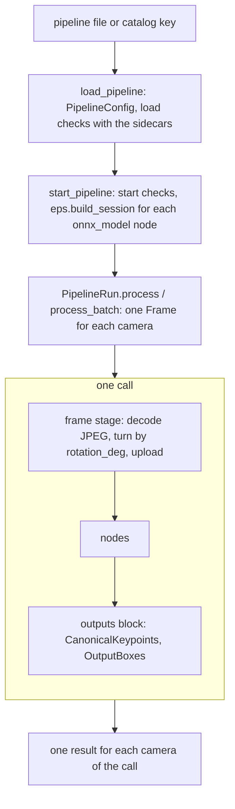

import { AiGeneratedBanner } from '@freemocap/skellydocs';

<AiGeneratedBanner />

# Architecture

skellytracker runs a **pipeline**: one YAML file that connects models and glue steps into a graph.
A run takes the file and the frames of one or more cameras. It gives the outputs of each camera.

## Two specifications

- The [pipeline spec](https://github.com/freemocap/skellytracker/blob/development/specs/pipeline/README.md)
  defines the pipeline file: the nodes, the ports, the outputs, the running modes, the timing and the taps.
- The [sidecar spec](https://github.com/freemocap/skellytracker/blob/development/specs/model-sidecar/README.md)
  defines the model processing: the preprocessing, the inference and the postprocessing of one ONNX
  model. A sidecar is one YAML file beside the ONNX files of a model family.

The pipeline spec never defines model processing. An `onnx_model` node reads its sidecar.

## Entry points

| Module | Role |
|--------|------|
| `skellytracker.core.pipelines` | Loads, checks and runs a pipeline file. |
| `skellytracker.core.detectors` | The catalog of the models (the sidecars), and `create_detector` for one detector. |
| `skellytracker.core.eps` | The EP catalog, the EP store, the recommendation and the session build. |
| `skellytracker.certify()` | The certification checks of the package. |

A plain import of `skellytracker` or of one of the three modules loads no `onnxruntime` and no
`mediapipe`. The package imports them in the function that needs them.

## The flow of a run



1. `load_pipeline` reads a key, a file or a mapping. The Pydantic model `PipelineConfig` does the
   structural checks. The load then reads the sidecars of the `onnx_model` nodes and does the checks
   that need them.
2. `start_pipeline` does the start checks before frame 0. It builds one ONNX Runtime session for each
   model with `eps.build_session()`. The nodes of one run with the same artifact, batch, EP, EP options
   and device share one session. Two runs share no session.
3. Each call gives one `Frame` for each camera. The frame stage decodes each JPEG buffer and turns each
   frame by its `rotation_deg`. On a GPU path, it also copies the frame to GPU memory.
4. The nodes run on the frame port `frame.image` and on the ports of other nodes. An input with the
   suffix `@prev` reads the value of the previous frame.
5. The `outputs` block converts the named ports to the delivered values. See
   [Output Values](./output-values).

## Nodes

A node is one ONNX model (`onnx_model`), one MediaPipe Tasks landmarker (`mediapipe_tasks`) or one
glue node. The glue nodes are a closed set: `boxes_from_points`, `hold_boxes`, `gate`, `first_of`,
`assign_keypoints`, `merge`, `flag_when`, `smooth_keypoints`, `smooth_boxes` and `redetect_trigger`.
A pipeline file runs no user code. A new node type is a change of the pipeline spec.

The command `skellytracker nodes` lists the node types with their ports and params:

```bash
uv run skellytracker nodes
```

## Cameras and GPUs

The cameras stay separate. No output joins the values of two cameras. Each temporal node keeps a
separate state for each camera. A run with two or more GPUs splits its cameras over the GPUs at the
start. Each GPU runs the whole pipeline for its cameras. The split uses the free VRAM of each GPU minus
the VRAM reserve. [Multi-Camera Batching](../guides/multi-camera-batching) gives more detail.

## Package layout

The paths are under `skellytracker/`.

| Path | Role |
|------|------|
| `core/pipelines/` | The pipeline API: `config.py`, `loading.py`, `catalog.py`, `run.py`, `values.py`, `canonical.py`, `timing.py`, `annotate.py`, `cli.py`. |
| `core/pipelines/_runtime/` | The private runtime: the load checks with the sidecars, the executor, the sessions, the taps and one module for each node type. Code outside `core/pipelines/` must not import it. |
| `core/detectors/` | The model catalog (`catalog.py`), the factory (`factory.py`), the generic ONNX detectors (`generic/`) and the processing modules of the sidecar spec (`processing/pre/`, `processing/post/`). |
| `core/model_spec/` | The loader and the validation rules of the sidecar spec. |
| `core/model_zoo/` | The package sidecars (`detectors/`), the landmark schemas and the built-in pipeline files (`pipelines/`). |
| `core/decode/` | The JPEG decoders of a run: the CPU decoder and the nvJPEG decoder for `cuda` and `trt-rtx`. |
| `core/eps/` | The EP catalog, the EP store, the session build and the CLI `skellytracker-eps`. |
| `core/system/`, `core/metrics/` | The facts of the host that do not change while the application runs, and the live system values. |
| `core/errors.py` | The errors of `eps` and of the pipeline runtime, and the exit codes of the CLIs. |
| `certification.py` | `certify()` and `certify_plan()`. |

The folders `core/tracker/` and `core/sessions/` hold the old run code. The folder `core/sidecar/`
holds the old sidecar loader. New code must not use them. A planned stage of the implementation
deletes the old run code.

## See also

- [Pipeline Overview](../core-concepts/pipeline-overview)
- [ONNX Runtime and EPs](./onnx-runtime-and-eps)
- [API Reference](./api-reference)
